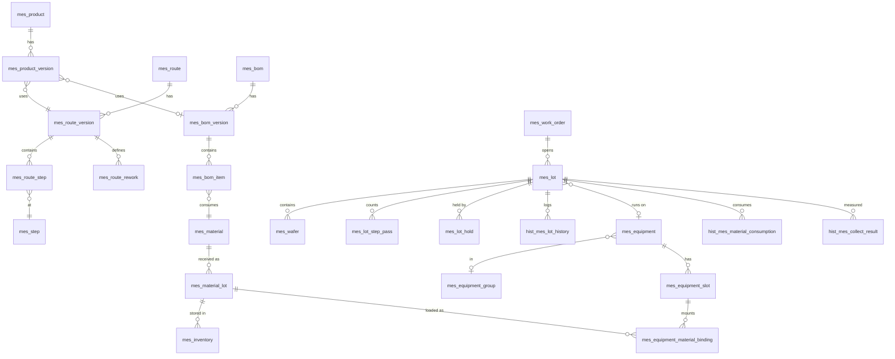

# 半导体通用 MES 设计文档

> 状态:**设计草案,待核对**,尚未实现任何代码。功能范围见 [mes-feature-list.md](./mes-feature-list.md)(v8)。**首期只支持 MySQL 8**(D20)。
> 本目录下 `M0`–`M13` 与功能清单里程碑一一对应;每个里程碑含 `design.md`(规则、表设计、接口、验收)与 `schema.sql`(草案 DDL)。
> 表设计共 **138** 张新表,字段文档与 DDL 由同一份规格生成,二者保持一致。

## 1. 里程碑索引

| 里程碑 | 主题 | 新增表 | 变更表 | 文档 |
|---|---|---|---|---|
| M0 | 地基与骨架 | 9 | 0 | [design](./M0/design.md) · [schema](./M0/schema.sql) |
| M1 | 主数据 I:独立实体 | 15 | 0 | [design](./M1/design.md) · [schema](./M1/schema.sql) |
| M2 | 主数据 II:制程与版本 | 15 | 3 | [design](./M2/design.md) · [schema](./M2/schema.sql) |
| M3 | 执行核心 | 9 | 0 | [design](./M3/design.md) · [schema](./M3/schema.sql) |
| M4 | 执行扩展 | 12 | 4 | [design](./M4/design.md) · [schema](./M4/schema.sql) |
| M5 | Batch 组批 | 2 | 3 | [design](./M5/design.md) · [schema](./M5/schema.sql) |
| M6 | 封测后段:单位转换与载具 | 7 | 4 | [design](./M6/design.md) · [schema](./M6/schema.sql) |
| M7 | 轻量库房 | 12 | 0 | [design](./M7/design.md) · [schema](./M7/schema.sql) |
| M8 | 管控完整化 | 14 | 0 | [design](./M8/design.md) · [schema](./M8/schema.sql) |
| M9 | 物料执行与自动反冲 | 5 | 1 | [design](./M9/design.md) · [schema](./M9/schema.sql) |
| M10 | 采集与质量判定 | 9 | 1 | [design](./M10/design.md) · [schema](./M10/schema.sql) |
| M11 | 追溯与报表 | 2 | 0 | [design](./M11/design.md) · [schema](./M11/schema.sql) |
| M12 | 上线准备与平台增强 | 12 | 7 | [design](./M12/design.md) · [schema](./M12/schema.sql) |
| M13 | 质量 / 维保 / 高级分析 | 15 | 0 | [design](./M13/design.md) · [schema](./M13/schema.sql) |

实现顺序即上表顺序;依赖关系见各 `design.md` 头部。

## 2. 表设计约定

沿用现有 `backend-db` 框架的约定,并为 MES 补充几条:

| 项 | 约定 |
|---|---|
| 表名 | 业务表 `mes_*`;历史/流水/日志表 `hist_mes_*`(命中 `app.cache.exclude-tables=hist_*`,不走透明查询缓存) |
| 只增表 vs 时间段表 | `hist_*` 分两类:**只增表**(无 `update_*`,用 `AppendOnlyEntity`,只 insert/查询);**时间段表**(设备状态段 `hist_mes_equipment_status`、载具绑定 `hist_mes_carrier_binding`,保留 `update_*`,只允许回填结束字段)。凡"只增不改"的表一律用 `hist_` 前缀。唯一的只增表例外:`hist_mes_genealogy_link.txn_id` 在原事务已撤销、关系再次发生时改指向新事务(专用 SQL,见 M3) |
| 主键 | `id BIGINT`,雪花 ID(`IdType.ASSIGN_ID`);业务编码另设 `*_code` / `*_no`,在租户内唯一 |
| 租户 | `tenant_id VARCHAR(64) NOT NULL`;**所有唯一/普通索引以 `tenant_id` 打头**(一个租户 = 一个厂区) |
| 审计 | `create_by/create_at/update_by/update_at`;只增表只含 `create_*` |
| 用户标识 | 统一存用户名(`sys_user.user_name`,如 `operator`/`create_by`/`user_name`),不存 `sys_user.id` |
| 删除 | **MES 表不用软删除**(继承 `NonSoftDeletableEntity`);主数据用 `enabled` 停用,被引用时拒绝物理删除(`DeleteReferenceUtils`);单据用状态;历史表只增不改 |
| 启用 | `enabled TINYINT(1)`,对应 `StateEnum`(0 禁用 / 1 启用) |
| 枚举 | 其余枚举一律 `VARCHAR` 存枚举名(如 `RUNNING`),可读且便于扩展;Java 侧用 `enum`,不用数字码 |
| 乐观锁 | 并发修改频繁的对象带 `version INT`,实体标 `@Version`;**M0 需在 app-common 补注册 `OptimisticLockerInnerInterceptor`**(现状未注册),影响行数为 0 必须抛错 |
| 外键 | **不建物理外键**,`*_id` 为逻辑引用,应用层校验;与现有库一致 |
| "空表示通用" | 出现在唯一键里的可选限定一律 `BIGINT NOT NULL DEFAULT 0`,**0 = 通用/不限**(产品、Recipe、物料、Route 步骤等),不用 NULL——MySQL 唯一键对 NULL 不去重会产生重复行 |
| 数量 | 件数/片数用 `BIGINT`/`INT`;物料量用 `DECIMAL(18,4)`;换算系数 `DECIMAL(18,6)` |
| 字符集 | `utf8mb4` / `utf8mb4_unicode_ci`,与现有迁移脚本一致 |
| JSON | 仅用于扩展与快照(规则参数、明细快照),不用于需要检索/约束的数据 |
| 迁移 | 草案 `schema.sql` 在实现时转为 `db/migration/mysql/V1_1_<n>__mes_m<n>.sql`(现有基线至 `V1_0_2`)。**只写 MySQL**,项目中没有多库转换脚本,其他库不在范围内。菜单/权限(全局表)写 `R__system_data_mes.sql`(需排在 `R__system_data` 之后);字典/参数/角色授权/内置规则由 `MesTenantInitializer` 按租户初始化 |
| 排序规则 | MES 表用 `utf8mb4_unicode_ci`;**不与 `sys_dict_*`(部分为 `utf8mb4_0900_ai_ci`)做 SQL 关联**,避免 1267 |

## 3. 模块与依赖

```
app-common
   └── app-mes-core        编号规则 / 对象锁 / 统一事务 / 领域事件 / 预警 / 导入框架 / 打印 / 通知 / 班次日历 / UDA   (M0 起)
          ├── app-mes-base        主数据:产品、Route(含返工/条件跳转)、站点、设备、物料、BOM、Recipe、工具、资格、规则、ECN
          ├── app-mes-warehouse   库房、库位、物料批、库存、收发料、盘点
          ├── app-mes-exec        工单、Lot、Wafer、Batch、Carrier、Interlock 执行、采集、物料执行、追溯、交接班
          ├── app-mes-quality     缺陷、NCR、MRB、良率(M13,可选)
          └── app-mes-maint       PM、Qual、维修(M13,可选)
app-boot 聚合以上全部;quality/maint 由 app.mes.quality.enabled / app.mes.maint.enabled 控制装配
```

- 业务模块之间**不直接依赖**,只经 `app-common` 里的 `share.integration.mes.*` 契约通信,实现放提供方模块。
- **契约放 app-common 的边界**:沿用框架已有的 `share.integration.system`(`TenantProvider`)、`share.integration.realtime` 先例,`share.integration.mes.*` 只允许放**接口(provider)、请求/响应 DTO(command/response)、事件载荷(event)与枚举**;禁止放实体、Mapper、仓储、Service 实现与任何业务规则。架构测试检查该包下无 `@Service/@Component/@Mapper` 与对 `com.scaffold.mes.*` 的 import。
- 相比功能清单最初的 D13 新增了 **`app-mes-core`**:统一事务层、编号、锁、预警、导入等**有实现的共用能力**被多个业务模块共用,放任何一个业务模块都会造成互相依赖;放 `app-common` 又违反"common 不含业务实现"的规定。契约(纯接口)与实现(core)由此分开。

## 4. 核心关系(简图)



## 5. 关键设计决策(核对重点)

1. **新增 `app-mes-core` 模块**(见上)。
2. **并发控制**:事务内对 工单→设备→Lot→Wafer 按序 `FOR UPDATE NOWAIT`,冲突立即报"对象被占用";`mes_object_lock` 仅用于跨请求的长占用(如 Batch 组批)。
3. **事务流水**:失败事务与 Interlock BLOCK 日志在业务事务回滚之后用新事务写;幂等键仅在 SUCCESS 时写入;撤销关系靠 `ref_txn_id` 反查,不回写历史。
4. **经过次数显式计数**(`mes_lot_step_pass`),不从历史推导;Route 步骤级覆盖(Recipe/规格/抽检/工具)按"步骤 → 站点+产品 → 站点"查找。
5. **Hold 作为叠加标记**(`hold_count` + `mes_lot_hold`),不进入 Lot 主状态;系统 Hold 靠 `active_key` 幂等。
6. **Lot 状态**含 `MERGED`(合批)与 `CONSUMED`(被封装投入耗尽),不再借用 `TERMINATED`。
7. **工单进度异步汇总**,按起始单位核算;转换后的 Die/Unit 级报废不计入工单。
8. **纠错事务**:只撤销最后一笔有效事务,逐类补偿处理器 + `before_json` 快照;转换/出货/拆合批不可撤销。
9. **MES 表不用软删除**;枚举用字符串;"空表示通用"用 0 哨兵。
10. **追溯关系表去重**(同对象对同类型同站点一条),消耗/反冲不逐次写关系。
11. **MES 首期只支持 MySQL**:NOWAIT、JSON、唯一键多 NULL、`INSERT … AS new ON DUPLICATE KEY UPDATE`(8.0.19+)均按 MySQL 8 设计;非 MySQL 库启动时拒绝启用 MES。
12. **业务事务内禁止 `REQUIRES_NEW`**:独立提交只在事务外——事务前取号、事务后写失败流水/BLOCK 日志、`mes_object_lock` 由独立请求处理;"失败不阻塞"用 `NESTED` 或预校验;一次写请求最多持有 1 个连接。事务内产生的子 Lot 号用"父 Lot 号 + 拆批序号",不取号。
13. **锁分级**:聚合根(设备/Lot/Wafer/Batch/Carrier)NOWAIT;共享热点(计数器)原子更新;库存/工具行短等待;锁序 工单→设备→Lot→Wafer→其他。
14. **步骤级覆盖独立成表**(`mes_route_step_*`,随 Route 版本复制/只读),与站点级绑定分开,覆盖语义是**整体替换**。
15. **产品版本绑定 `route_id/bom_id`**,下工单时固化具体版本到工单与 Lot,升版无需重发产品版本。
16. **撤销登记**:`hist_mes_txn_reversal`(`orig_txn_id` 唯一),统计/追溯统一经它排除已撤销事务。
17. **领域事件按订阅者投递**(`mes_domain_event_delivery`):每个订阅者的业务写入与投递状态同事务提交,独立重试;同一聚合按顺序投递,撤销不会先于出站被处理。事件目录见 M0 第 3.1 节。
18. **Undo Track-Out 恢复为 RUNNING**(按 `before_json`,允许 COMPLETED→RUNNING),之后仍可 Cancel Track-In。
19. **Batch 整体占 1 个设备名额**,批级物料(PER_RUN/PER_TIME)一炉只扣一次;**Time Link 按 Lot 独立计时**(`mes_lot_time_link_timer`)。

## 6. 对现有框架的修正(M0 必做)

经核对 `backend-db` 源码,以下是设计依赖但框架**现状没有**的能力,已在 M0 范围内补齐:

| 现状 | M0 动作 |
|---|---|
| `MybatisPlusConfig` 未注册 `OptimisticLockerInnerInterceptor`,无 `@Version` | 在 app-common 补注册,约定影响行数为 0 抛错 |
| `share.scheduling` 包为空;ShedLock 仅在父 POM 声明,无表 | 引入依赖与 `shedlock` 表;`TenantAwareScheduledTask` 按租户遍历 |
| 无会话的后台任务租户回落到 `DEFAULT_TENANT` | 任务基类显式设置租户上下文 |
| 元数据处理器按字段是否存在填充 `update_*`(对无该字段的实体无副作用),约束来自 `BaseEntity` 接口(见下行) | 新增 `AppendOnlyEntity` + 只增仓储支撑,只增表不含 `update_*` |
| 种子写死单个租户 ID | `MesTenantInitializer` 对新租户/已有租户幂等初始化 |
| `@MapperScan` 带 `annotationClass = Mapper.class` | 规则:MES Mapper 接口必须标 `@Mapper`,包名含 `.mapper` |
| `DbRepositorySupport.update()` 返回 `void`,不暴露影响行数 | 新增 `updateWithVersion()`,影响行数为 0 抛错 |
| `BaseEntity` 接口强制 `update*` 访问器,仓储与批量填充绑定其上 | 只增表用独立的 `AppendOnlyEntity` + `AppendOnlyRepositorySupport` |
| `sys_permission` 是全局表(租户拦截器不过滤) | 菜单/权限只写一次;按租户只初始化字典/参数/授权/内置规则 |
| `SecurityCurrentSessionProvider` 优先取登录主体租户,请求内的 `TenantContextHolder.runAs` 不生效(现有 `UserApplicationService.deleteUserInfo` 跨租户删角色也受影响) | 修正 provider 优先级:`runAs` 设置的显式租户优先于登录主体;不新增 `TenantScope`。新增 `TenantCreatedEvent` 契约 |
| 框架 README 宣称同一 jar 可换 4 种库 | 启用 MES 后仅支持 MySQL;实现时在 `backend-db/README.md` 换库说明处注明 |
| 可重复迁移按描述字母序,`R__mes_data` 会排在 `R__system_data` 之前 | 改名 `R__system_data_mes.sql` |
| `shedlock-spring` 声明但无 JDBC provider | 补 `shedlock-provider-jdbc-template`,`usingDbTime()`;租户遍历用现有 `TenantProvider.findAllTenants()` |
| `findOne` 用 `.last("LIMIT 1")`(MySQL 可用) | 首期仅 MySQL,不处理;未来多库时需替换 |

## 7. 审核修订对照(2026-10-16,Opus 5.5 审核全部采纳)

| 审核项 | 处理位置 |
|---|---|
| B1 锁与事务矛盾 | M0 并发规则;`mes_object_lock` 仅长占用 |
| B2 流水/幂等/撤销自相矛盾 | M0 `hist_mes_transaction`(`idem_key`/`parent_txn_id`/REQUIRES_NEW,不回写) |
| B3 锁范围、设备容量、工单计数热点 | M0/M3 加锁顺序;工单进度异步汇总;热表排除缓存 |
| B4 `pass_no` 推导不可靠 | M3 `mes_lot_step_pass` |
| B5 重入步骤绑定无法区分层 | M2 步骤级覆盖(`route_step_id`) |
| B6 纠错补偿不全 | M4 纠错通则 + 补偿处理器 + `before_json` |
| B7 形态转换源 Lot 去向 | M3 `MERGED/CONSUMED`;M6 形态转换扣减规则 |
| B8 与框架冲突 | M0 乐观锁、AppendOnly、调度底座、租户种子;`hist_` 前缀统一 |
| I1 版本状态机矛盾 | M1/M2 任一时刻单 ACTIVE |
| I2 返工/条件跳转归属 | M4 迁至 base,随 Route 版本复制/只读 |
| I3 返工位置信息 | M3 历史加 `rework_id/rework_seq_no`;M4 次数按历史统计 |
| I4 计数单位混算 | M3 `current_scrap_qty`、`unit_before/after`;M6 工单口径;M11 快照分单位 |
| I5 良品数与 Wafer 不一致 | M3 数量口径 |
| I6 Hold 随回滚丢失 | M4 Future Action `ON_ARRIVE`;M3 Hold `active_key` 幂等 |
| I7 Split/Merge 规则缺失 | M4 继承规则与 Merge 约束 |
| I8 设备状态联动覆盖人工状态 | M1 `status_source`;M3 联动与停机放行规则 |
| I9 无设备/无 Recipe 站点 | M1 `need_equipment/need_recipe` |
| I10 概念多套模型 | M2 能力与资格合一;M4/M6 载具与容器边界;M13 良率单一数据源 |
| I11 可空唯一键 | 全局 0 哨兵(约定 + 各表) |
| I12 物料执行缺口 | M7 批号唯一/批状态推导/冻结口径/线边库位;M9 下料处置、欠账、防重复反冲 |
| I13 采集结果更正 | M10 `record_type/ref_id` |
| I14 模块归属 | M12 core/base/exec 重分配 |
| I15 依赖与最小线 | M0 `mes_alert` 前移;最小线加入 M8;M6/M7 依赖修正 |
| I16 取号热点 | M0 雪花 ID 流水号;业务单号 REQUIRES_NEW |
| I17 缓存与热表 | M0 排除缓存清单 |
| I18 新租户种子 | M0 `MesTenantInitializer` |
| S1–S13 | M5/M6/M3/M9/M11/M13/M8 对应条目;用户标识统一;`@Mapper` 要求;站点组、Inhibit、来料 Wafer 清单等补入 |

### 第二轮复审(2026-10-16,Opus 5.5;全部采纳,首期仅 MySQL)

| 审核项 | 处理位置 |
|---|---|
| A1 可空唯一键四库语义 | 首期仅 MySQL(D20),NULL 允许多个;M0 记录"多库需另立项";Hold/关系幂等改"持锁先查后插,唯一键兜底" |
| A2 REQUIRES_NEW 与行锁自阻塞 | M0 `REQUIRES_NEW` 使用规则 + NESTED;M4 Future Action 失败处理;M5 部分成功改逐 Lot 独立事务 |
| A3 工单口径与终态 | M3 终态集合与迁移矩阵、起始单位守恒、开批锁工单行实时校验;M6 完工口径 |
| A4 `uk_backflush` 冲突 | M9 每笔修正/Undo 有独立 `txn_id`,唯一键加 `binding_id/location_id` |
| A5 Die 数量对账 | M6 Die 数量不变式、`hist_mes_die_bin_log`、汇总行/逐片行不并存 |
| A6 纠错通则矛盾 | M4 隐式 Split 可补偿、显式不可逆、设备状态追加段补偿、含 Future Action SPLIT 的出站不可撤销 |
| A7 设备状态联动覆盖停机态 | M3 Track-In 仅在 STANDBY/TRACK 来源时联动 |
| B1 NOWAIT 用于共享行 | M0 锁分级;M10 抽检计数器原子更新 |
| B2 步骤覆盖归属与语义 | M2 `mes_route_step_recipe`;M8/M10 步骤级表;替换语义;计数器键含 `route_step_id`;`mes_lot.recipe_override_*` |
| B3 产品版本绑定具体版本 | M2 绑定 `route_id/bom_id`,工单固化版本 |
| B4 连接池 | M0 连接池约束,取号前置 |
| B5 到站钩子 | M3 `ArrivalHook`,M4 所有改步骤路径统一调用 |
| B6 Move Back 与抽检/采集冲突 | M4 Move Back 不回减 `pass_count` |
| B7 拆批绕过返工上限 | M4 返工次数按 `(root_lot_id, rework_id)` 统计 |
| B8 Hold 期间 Split | M3 允许清单加入 Split |
| B9 排除已撤销事务 | M0 `hist_mes_txn_reversal` |
| B10 Port 缺状态来源 | M2 `mes_equipment_port` 补字段 |
| B11 WIP 导入字段 | M12 WIP 初始化完整字段 |
| B12 缓存排除遗漏 | M0 `mes_*` 全部排除 |
| B13 工具绑定无处存放 | M8 `TRACK_IN_BIND` 事件 + `txn_id` |
| B14 性能与冗余索引 | M3 Wafer 历史不逐片写、`before_json` 仅可撤销类型、删 4 个冗余索引;M10 `product_id` 与索引 |
| 框架断言修正 | 见第 6 节新增行 |
| 文档残留与功能清单不一致 | v6 功能清单已同步 |

### 第三轮一致性修订(2026-10-16;契约位置按决定保留 app-common)

| 问题 | 处理位置 |
|---|---|
| C1 MES 契约放 app-common 与"common 不含业务"的张力 | 保留 app-common;第 3 节与 M0 限定契约包只含接口/DTO/事件/枚举,架构测试校验 |
| C2 `TenantScope` 与现有 `TenantContextHolder.runAs` 重复 | M0 改为修正 `SecurityCurrentSessionProvider` 优先级,不新增 `TenantScope` |
| C3 schema 头部"转换脚本"与只支持 MySQL 矛盾 | 14 个 `schema.sql` 头部改为"首期只支持 MySQL 8(D20)" |
| L1 追溯去重后按 `txn_id` 过滤会藏掉"撤销后又发生"的关系 | M3 `ON DUPLICATE KEY` 改指向新事务(只增表唯一例外,见第 2 节) |
| L2 `idem_key` 长度不足(最长 97) | M0 改 `VARCHAR(100)` |
| L3 BOM `route_seq_no` 与独立升版的 Route 脱钩 | M2 下工单固化时校验,产品版本提审预检,Route 生效时预警 |
| L4 完工口径把 TERMINATED 计为完成 | M3 终态分完成态/关闭态;工单加 `terminated_qty`;M6 口径重写 |
| L5 事务内 Split 无法事务前取号 | M0/M4 子 Lot 号 = 父 Lot 号 + `split_seq` |
| R1 `REQUIRES_NEW` 规则前后矛盾 | M0 统一为"业务事务内禁止";README 决策 3/12、D21 同步 |
| R2 状态矩阵缺 RUNNING→COMPLETED、终态定义冲突 | M3 迁移矩阵重写 |
| R3 PM 计数同步/异步未定 | M13 定为事件异步(`TXN_REVERSED` 回退,M0 发布),2026-10-16 已确认;M4 补偿清单同步 |
| R4 残留 | M3 Track-In 不写 Wafer 历史;M10 计数键含 `route_step_id`、计数放事务末尾;M2 验收按里程碑拆分;功能清单 v7 同步 |

### 第四轮审查修订(2026-10-16;38 项,按推荐方案全部采纳)

| 问题 | 处理位置 |
|---|---|
| H1 事件单状态多订阅者;PM 计数无法去重/回退;`LOT_TRACK_OUT` 未定义 | M0 `mes_domain_event_delivery` + 事件目录;M3 出站发布事件;M13 `hist_mes_pm_count_log` |
| H2 Merge 后源 Lot 数量未清零,工单与开批重复计算 | M4 Merge 清零源 Lot 数量 |
| H3 Batch 第 2 个 Lot 被设备容量规则拒绝 | M5 `EQP_CAPACITY` 按 Batch 去重计数 |
| H4 Time Link 起点被中间站点覆盖 | M8 `mes_lot_time_link_timer`;M2/M3/M4/M12 引用同步 |
| H5 Undo Track-Out 状态与矩阵冲突 | M3 迁移矩阵加 COMPLETED→RUNNING;M4 Undo 恢复为 RUNNING |
| 契约与可选模块缺失 | M0 首批契约;M1 `EquipmentStatusProvider`;M3 `WorkOrderProvider/LotCommandProvider`;M7 `InventoryProvider`;M13 模块与开关 |
| M10 采集与抽检 4 项 | M10 `COLLECT` 事务、有效值取最后一条、抽检挂到下一步解析/到站钩子、计数不回退 |
| M5 Batch 4 项 | M5 父事务口径、剔除单一事务、`batch_id` 生命周期、批级物料只扣一次 |
| M9 物料 5 项 | M9 差额行、欠账 `SETTLE`、Undo 净消耗、`MATERIAL_CONSUMED/ISSUED`、来料 Wafer 清单 |
| M8 工具与规则 3 项 | M8 工具状态迁移、`UNBIND/USE_REVERSAL` + `bind_txn_id` + `idx_txn`、内置规则类型与不可停用 |
| 其他中等 | M3 NCR Hold `source_ref_id`;M13 盘点全程锁;M1/M2 生效锁主表行;M7 单据确认走事务层;M2 能力匹配与有效期;M6 封装余量置 CONSUMED;M4 预约绑定 Route 版本;M0 PM 计数移出业务事务;M9 范围措辞 |
| 低 | M13 良率 `txn_id`;M12 `mes_file`;M4/M6 BOX/FRAME 边界;M6 `is_current` 与流水枚举;M1 Recipe 审批状态;M0 多级拆批长度;M4 Bonus 在制态 |

### 第五轮开发前复核(2026-10-16)

| 问题 | 处理 |
|---|---|
| `count.as.one=false` 仍用按 Batch 去重的计数式 | M5 改为逐 Lot `COUNT(*)` |
| 直耗 `binding_id` 写成空,列却是非空 0 哨兵 | M9 改为 `binding_id=0` |
| 消耗按 SUM 又排除已撤销事务,撤销后会得到负数 | M9/M0 改为负数行入账、SUM 不再排除 |
| 工单进度与撤销事件可能并发写同一工单行 | 撤销事务重发 `WORK_ORDER_PROGRESS`;`TXN_REVERSED` 只给 `PM_COUNTER`;同聚合按序投递 |
| Split 原样复制 `active_key` 会撞唯一键 | M3/M4 按子 Lot 重写 |
| 出站时抽检计数、工具、库存的加锁顺序未定 | M0 固定为计数器 → 工具 → 库存;重算含 `terminated_qty` |

## 8. 前端说明

`soybean-admin/src/views/rtd`、`service/api/rtd` 实际是脚手架的**系统管理与日志页面**(用户/角色/权限/字典/租户/版本/日志),只是沿用了 `rtd` 目录名,**不是 RTD 功能,不清理**。MES 页面放 `views/mes`、`service/api/mes`,与之并列。

各里程碑末尾的"待确认"汇总了尚未决定的细节问题。
